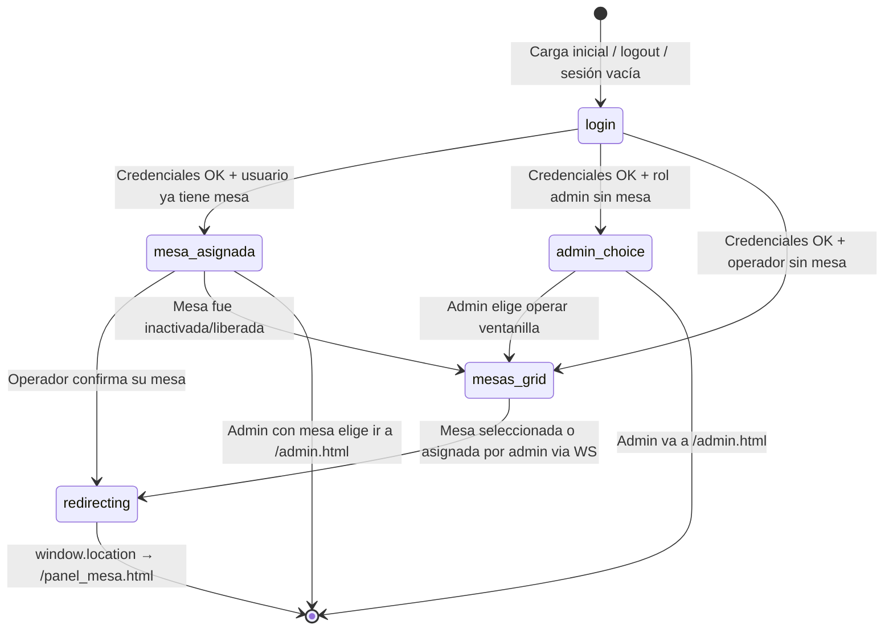
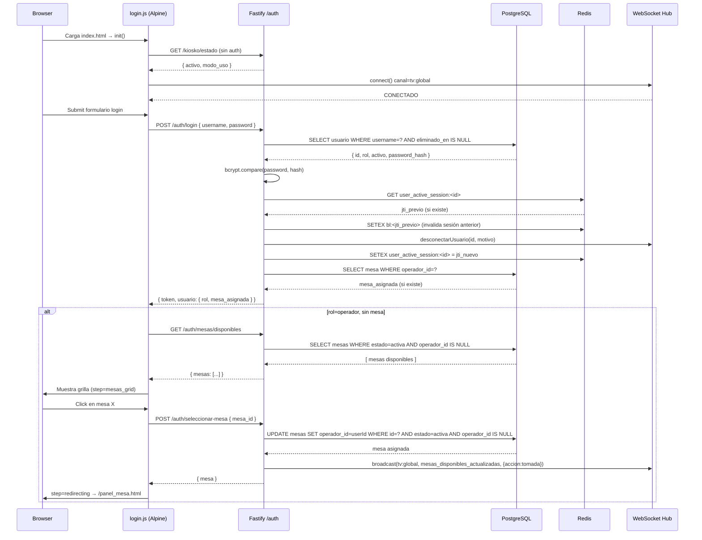

# Login — Especificación Completa de Frontend
> **Turnero de Matrículas 2026 · v2.1** — Acceso, Sesión y Selección de Mesa  
> Archivos: [`index.html`](file:///c:/Users/windows%2010%20pro/Downloads/Turnero/src/public/index.html) · [`login.js`](file:///c:/Users/windows%2010%20pro/Downloads/Turnero/src/public/js/pages/login.js) · [`api.js`](file:///c:/Users/windows%2010%20pro/Downloads/Turnero/src/public/js/api.js) · [`ws-client.js`](file:///c:/Users/windows%2010%20pro/Downloads/Turnero/src/public/js/ws-client.js)

---

## 1. Arquitectura de la Vista

La pantalla de acceso es una **Single Page sin recarga**: `index.html` aloja un componente Alpine.js (`loginView()`) que controla todo mediante un estado `step`. El HTML nunca cambia de URL durante el flujo de login y selección de mesa.



### Steps del estado `step`

| Valor | Vista visible | Cuándo ocurre |
|---|---|---|
| `login` | Formulario de credenciales | Inicio, logout, sesión vacía |
| `admin_choice` | Opciones de acceso privilegiado | Admin sin mesa post-login |
| `mesa_asignada` | Confirmación de mesa pre-asignada | Cualquier rol con mesa ya asignada |
| `mesas_grid` | Grilla de mesas disponibles | Operador sin mesa / admin elige operar |
| `redirecting` | Pantalla de transición con spinner | Antes del redirect a `/panel_mesa.html` |

---

## 2. Estructura Visual de Cada Paso

### 2.1 Formulario de Login (`step === 'login'`)

- Tarjeta centrada `max-w-md` con fondo `bg-white`, borde `border-[#CBD5E1]`, `rounded-2xl`.
- **Campo usuario/DNI:** `input-field` con icono SVG de persona a la izquierda.
- **Campo contraseña:** Toggle de visibilidad (ojo) a la derecha. Nunca se queda en texto plano al volver al formulario (`password: ''` se limpia en `volverLogin()`).
- **Botón principal:** `btn-primary h-12 w-full` — texto dinámico `textoBotonLogin` (`"Iniciar sesión"` / `"Validando..."`), con spinner durante `loading`.
- **Alerta de error:** `alert-danger` con `aria-live="assertive"` — visible solo si `errorMessage` no está vacío.
- **Links externos:** Botón Kiosko (condicional: solo si `kioskoActivo === true`) y botón TV siempre visible — ambos abren en pestaña nueva.

### 2.2 Acceso Privilegiado — Admin (`step === 'admin_choice'`)

- Tarjeta `max-w-lg`. Muestra nombre y rol del usuario (`currentUser?.nombre`, `currentUser?.rol`).
- **Dos opciones** en forma de cards con icono + descripción:
  1. "Ir al panel de administración" → `irAdmin()` → `window.location.href = '/admin.html'`
  2. "Operar en un sitio / lugar" → `irOperarMesa()` → refresca `/auth/me` primero, luego decide entre `mesa_asignada` o `mesas_grid`
- Enlace "Cerrar sesión y volver" en el footer de la tarjeta.

### 2.3 Mesa Asignada (`step === 'mesa_asignada'`)

- Tarjeta `max-w-md` con badge verde (número de mesa) y alert ámbar de aviso físico.
- **Botón primario:** "Continuar en mi mesa" → llama a `continuarMesaAsignada()` que hace un `GET /auth/me` de validación final antes de redirigir.
- **Botón admin** (solo si `currentUser?.rol === 'admin'`): "Ir al panel de administración".
- **Botón cancelar:** "Cancelar" / "Cerrando sesión..." → llama a `volverLogin()` → logout + regresa al formulario.

### 2.4 Grilla de Mesas (`step === 'mesas_grid'`)

- Tarjeta `max-w-4xl`, grid de 1-4 columnas responsivo.
- Cabecera con botones "Opciones Admin" (visible solo para admin), "Actualizar" y "Cerrar sesión".
- **Estado vacío:** icono neutro + mensaje "No hay mesas disponibles. Contacte al administrador."
- **Estado cargando:** spinner centrado.
- **Grilla:** cada mesa es un botón `card-mesa-select` con número (JetBrains Mono), nombre, pill "Disponible" y texto "Tomar esta mesa".
- **La grilla es en tiempo real:** el WS actualiza las mesas al instante sin necesidad de pulsar "Actualizar".

### 2.5 Redireccionando (`step === 'redirecting'`)

- Tarjeta `max-w-md` con spinner azul, texto dinámico `redirectText` y mensaje "Cargando consola de atención...".
- Dura `350ms` (selección propia) o `1200ms` (asignación por admin) antes del redirect.

---

## 3. Flujo de Inicialización (`init()`)

Al cargar `index.html`, Alpine ejecuta `init()` automáticamente. La secuencia es:

```
1. Detectar ?logout=1 o ?sesion_cerrada=1 en la URL
   ├─ Si logout=1       → api.logout(false) → limpiar estado → mostrar login
   └─ Si sesion_cerrada → api.clearSession(false) → mostrar error "Sesión cerrada en otra ventana"

2. verificarKioskoActivo() — GET /kiosko/estado (sin auth)
   → Actualiza kioskoActivo, kioskoModoUso, kioskoUrlBase

3. _conectarWSMesas() — Canal tv:global para grilla en tiempo real

4. initFondoPersonalizado() — Aplica fondo institucional personalizado si existe

5. Verificar token existente en sessionStorage
   ├─ Sin token → permanecer en formulario (NO auto-login en pestaña nueva)
   └─ Con token → GET /auth/me para validar sesión
       ├─ OK  → _decidirPasoPostLogin(usuario)
       └─ KO  → clearSession(false) → mostrar login (sin redirect para evitar bucle)
```

> [!IMPORTANT]
> El `init()` **nunca auto-reanuda sesión en pestañas nuevas** si el sessionStorage local está vacío, aunque exista un `turnero_active_session` en localStorage de otra pestaña del mismo usuario. Esto es intencional: en PCs compartidas, cada pestaña nueva debe autenticarse de forma explícita.

---

## 4. Lógica de Decisión Post-Login (`_decidirPasoPostLogin`)

```javascript
_decidirPasoPostLogin(usuario)
  │
  ├─ usuario.mesa_asignada existe?
  │   └─ SÍ → step = 'mesa_asignada'   (cualquier rol: operador, admin, supervisor)
  │
  ├─ usuario.rol === 'admin'?
  │   └─ SÍ → step = 'admin_choice'
  │
  └─ (operador sin mesa) → step = 'mesas_grid' + cargarMesas() + _conectarWSMesas()
```

La propiedad `mesa_asignada` viene del servidor (`/auth/login` y `/auth/me`): es la mesa donde `operador_id = usuario.id` y `estado != 'inactiva'`.

---

## 5. Gestión de Sesión y Tokens

### 5.1 Almacenamiento Dual

| Almacén | Qué guarda | Cuándo se usa |
|---|---|---|
| `sessionStorage` | `token`, `usuario`, `turnero_mesa` | Sesión activa de **esta pestaña** |
| `localStorage` | `turnero_active_session` (objeto completo) | Sincronización entre pestañas del mismo navegador |

### 5.2 Ciclo de Vida del JWT

```
Login exitoso
  → JWT (2h) en sessionStorage
  → refresh_token en cookie HttpOnly (7d, path=/auth/refresh)
  → turnero_token en cookie httpOnly (path=/)

Petición con token expirado (api.js interceptor)
  → 401 detectado → _refreshToken() → POST /auth/refresh (cookie)
    ├─ OK  → nuevo token en sessionStorage → reintenta petición original
    └─ KO  → clearSession(redirect=true) → /index.html

Logout explícito
  → POST /auth/logout → blacklist jti en Redis → clearCookies → clearSession
  → BroadcastChannel: evento LOGOUT a otras pestañas del mismo navegador
```

### 5.3 Sesión Única por Cuenta (Multi-Dispositivo)

Cuando un usuario hace login desde un **dispositivo diferente** (o el mismo sin cerrar la sesión anterior):

1. El backend detecta que existe un `user_active_session:<id>` en Redis con un `jti` distinto.
2. **Invalida la sesión anterior** añadiendo el `jti` previo a la blacklist de Redis.
3. Llama a `fastify.desconectarUsuario(usuario.id, 'Sesión iniciada en otro dispositivo')` → cierra el WebSocket de la sesión desplazada.
4. La sesión desplazada recibe el cierre WS con código `4409` → `ws-client.js` emite evento `sesion_duplicada` → el frontend redirige a `/index.html?sesion_cerrada=1`.
5. El usuario en el dispositivo antiguo ve el mensaje: **"Su sesión fue cerrada porque se inició sesión en otra ventana."**

---

## 6. WebSocket en la Pantalla de Login

El WS se conecta al canal `tv:global` (sin autenticación) **desde el `init()`**, antes incluso del login. Esto permite que la grilla de mesas funcione en tiempo real.

### Eventos que escucha `login.js`

| Evento WS | Qué hace el frontend |
|---|---|
| `mesas_disponibles_actualizadas` | Llama a `_actualizarMesaEnGrid({ mesa, accion })` |
| `operador_asignado_por_admin` | Si `payload.operador_id === currentUser.id` → redirige a `panel_mesa.html` automáticamente |
| `operador_desasignado_por_admin` | Si es el usuario actual → limpia mesa, toast info, vuelve a `_decidirPasoPostLogin` |
| `config_actualizada` | Actualiza `kioskoActivo`, `kioskoModoUso`, `kioskoUrlBase` en tiempo real |

### Acciones sobre la grilla según el campo `accion`

| `accion` | Comportamiento |
|---|---|
| `tomada` | Elimina la mesa de la grilla (ya no disponible) |
| `inactivada` | Elimina la mesa de la grilla |
| `eliminada` | Elimina la mesa de la grilla |
| `liberada` | Agrega o actualiza la mesa y reordena por número |
| `actualizada` | Si activa sin `operador_id` → agrega/actualiza; si no → elimina |
| `pausada` | No afecta la grilla (mesa pausada no aparecía ya de todas formas) |

---

## 7. Catálogo Exhaustivo de Escenarios y Bordes

### 7.1 Credenciales y Estado del Usuario

#### Escenario: Usuario escribe credenciales incorrectas
- Backend ejecuta `bcrypt.compare` siempre (dummy hash si el usuario no existe) para evitar timing attacks.
- Si `!usuario || !passwordValido || !usuario.activo` → `LOGIN_FALLIDO` en `audit_log` → HTTP 401.
- Frontend muestra: **"Usuario o contraseña incorrectos."**
- El botón vuelve a estar habilitado. El campo contraseña no se borra (el usuario puede corregir).

#### Escenario: Usuario inactivo (`activo = false`)
- El backend devuelve el **mismo error 401** que credenciales inválidas.
- Frontend muestra: **"Usuario o contraseña incorrectos."** — intencionalmente ambiguo por seguridad, no revela si el usuario existe.
- No hay diferencia en la UX. El admin debe reactivar la cuenta desde el panel.

#### Escenario: Usuario eliminado (`eliminado_en IS NOT NULL`)
- La consulta del backend filtra `AND eliminado_en IS NULL`.
- Si el username coincide con un usuario eliminado, se comporta igual que si no existiera: dummy hash → 401.
- Frontend: **"Usuario o contraseña incorrectos."**

#### Escenario: Demasiados intentos (rate limiting)
- Límite: 10 intentos por minuto por IP (configurable con `RATE_LIMIT_LOGIN_MAX`).
- Backend responde HTTP 429: `{ codigo: 'demasiados_intentos', mensaje: 'Demasiados intentos. Intente de nuevo en 1 minuto.' }`.
- Frontend detecta `err.status === 429` o `err.codigo === 'servidor_ocupado'` → muestra el mensaje del servidor.
- Si el servidor incluye el header `Retry-After`, `api.js` guarda `retryAfterMs` en el error (disponible para el controlador si se quiere implementar un countdown).

#### Escenario: Sin conexión de red al intentar login
- `fetch()` lanza `TypeError` (red no disponible).
- Frontend detecta `!navigator.onLine || err.name === 'TypeError'` → **"Sin conexión con el servidor. Verifique su red."**

---

### 7.2 Flujo de Roles

#### Escenario: Operador se loguea sin mesa asignada por el admin
- `_decidirPasoPostLogin` → `step = 'mesas_grid'`.
- Se cargan las mesas disponibles via `GET /auth/mesas/disponibles`.
- El WS ya está conectado desde el `init()`, así que la grilla se actualiza en tiempo real sin polling.

#### Escenario: Admin se loguea por primera vez del día (sin mesa)
- `_decidirPasoPostLogin` → `step = 'admin_choice'`.
- Ve dos opciones: ir al panel admin o tomar una mesa de operador.
- Si elige "Operar en un sitio", `irOperarMesa()` hace un `GET /auth/me` para verificar si le asignaron mesa en el intervalo → si no tiene mesa, va a `mesas_grid`.

#### Escenario: Admin tiene mesa asignada y entra
- `_decidirPasoPostLogin` → `step = 'mesa_asignada'` (igual que un operador).
- Adicionalmente aparece el botón "Ir al panel de administración" en la tarjeta.
- Puede ir directamente al admin sin pasar por la mesa si lo prefiere.

#### Escenario: Supervisor se loguea
- El código actual trata a `supervisor` igual que `operador` (no tiene rama especial en `_decidirPasoPostLogin`).
- Flujo: sin mesa → grilla; con mesa → `mesa_asignada`.

---

### 7.3 Selección de Mesa en la Grilla

#### Escenario: Operador selecciona una mesa que fue tomada en ese preciso instante
- `POST /auth/seleccionar-mesa` intenta el UPDATE atómico en PostgreSQL.
- Si 0 filas actualizadas y `mesa.operador_id != userId` → HTTP 409 `mesa_ocupada`.
- Frontend: `showToast({ type: 'warning', message: 'Esta mesa acaba de ser tomada por otro operador.' })` + `cargarMesas()` para refrescar la grilla.

#### Escenario: La mesa fue inactivada por el admin justo antes de que el operador la seleccione
- HTTP 409 `mesa_inactiva`.
- Frontend: toast de aviso + `cargarMesas()`.

#### Escenario: La mesa fue eliminada por el admin
- HTTP 404 `mesa_no_encontrada`.
- Frontend: toast de aviso + `cargarMesas()`.

#### Escenario: El operador ya tenía mesa en BD (constraint `ux_mesas_operador_unico`)
- PostgreSQL lanza `23505 unique_violation`.
- Backend responde HTTP 409 `operador_ya_asignado` con `mesa_actual` en el cuerpo.
- Frontend: cierra el WS, guarda `mesaPreAsignada` con la mesa actual, `step = 'mesa_asignada'`.

#### Escenario: Todas las mesas están ocupadas (estado vacío de la grilla)
- `GET /auth/mesas/disponibles` devuelve `mesas: []`.
- `noHayMesasDisponibles` se hace `true` → se muestra el estado vacío.
- El operador puede pulsar "Actualizar" manualmente o **esperar**: el WS notifica automáticamente cuando una mesa queda libre (evento `mesas_disponibles_actualizadas` con `accion: 'liberada'`).

#### Escenario: El admin asigna una mesa al operador mientras este está en la grilla
- Backend hace `fastify.broadcast('tv:global', 'operador_asignado_por_admin', { operador_id, mesa })`.
- `login.js` recibe el evento, compara `payload.operador_id === currentUser.id`.
- Llama a `_redirigirConMesaAsignada(payload.mesa)`:
  - Cierra el WS.
  - Guarda la mesa en `sessionStorage`.
  - `step = 'redirecting'` con texto `"El administrador te asignó la Mesa X — Iniciando consola..."`.
  - Toast verde de confirmación.
  - Redirect a `/panel_mesa.html` en `1200ms`.

#### Escenario: El admin desasigna al operador mientras está en la grilla
- Evento `operador_desasignado_por_admin`.
- Si `payload.operador_id === currentUser.id` → limpia `mesaPreAsignada`, limpia sessionStorage, toast de información, vuelve a ejecutar `_decidirPasoPostLogin(currentUser)` para reubicar al operador.

---

### 7.4 Confirmación de Mesa Asignada

#### Escenario: El operador tiene una mesa asignada pero al pulsar "Continuar" la mesa fue inactivada
- `continuarMesaAsignada()` hace `GET /auth/me` justo antes de redirigir.
- Si `!usuario?.mesa_asignada || usuario.mesa_asignada.estado === 'inactiva'`:
  - Toast ámbar: "La mesa asignada ya no se encuentra activa o fue liberada."
  - Limpia `mesaPreAsignada` y sessionStorage.
  - Ejecuta `_decidirPasoPostLogin(usuario)` → va a la grilla o a `admin_choice`.

#### Escenario: El operador cancela en la pantalla de mesa asignada
- Pulsa "Cancelar" → `volverLogin()`:
  - `loading = true`, spinner en el botón.
  - `POST /auth/logout` al servidor (invalida token en Redis, cancela turno en atención si había).
  - `clearSession(false)` → limpia sessionStorage y localStorage.
  - `step = 'login'`, `password = ''`, `errorMessage = ''`, `currentUser = null`, `mesaPreAsignada = null`.

---

### 7.5 Gestión de Sesiones Multi-Ventana y Multi-Dispositivo

#### Escenario: Mismo usuario abre el sistema en dos pestañas del mismo navegador

**En la misma pestaña que ya tenía sesión:**
- `api.js` usa `BroadcastChannel('turnero_auth_sync')` + `localStorage.storage` event.
- Si la segunda pestaña hace login con el **mismo usuario**: `procesarCambioRemoto` detecta `nuevaSesion.userId === currentUser.id` → solo sincroniza el token, **no cierra la sesión**.

**Si la segunda pestaña hace login con un **usuario diferente**:**
- `procesarCambioRemoto` detecta `nuevaSesion.userId !== currentUser.id`.
- Llama a `clearSession(false)`.
- Si la pestaña no está en `/index.html`, redirige a `/index.html?sesion_cerrada=1`.
- Al cargar el login, el `init()` detecta `?sesion_cerrada=1` → muestra: **"Su sesión fue cerrada porque se inició sesión en otra ventana."**

#### Escenario: Usuario se loguea desde otro dispositivo / navegador (sesión nueva)
- El backend invalida la sesión anterior (jti previo a blacklist en Redis).
- `fastify.desconectarUsuario(usuarioId, 'Sesión iniciada en otro dispositivo')` cierra la conexión WS activa.
- El dispositivo antiguo recibe cierre WS con código `4409`.
- `ws-client.js` emite `sesion_duplicada` y `auth_error(4409)` → **no reintenta** la reconexión.
- Si el dispositivo antiguo está en `panel_mesa.html`, ese controlador reacciona a `auth_error` redirigiendo al login con `?sesion_cerrada=1`.

#### Escenario: Operador cierra la pestaña del panel sin hacer logout
- Al cerrar la pestaña, `sessionStorage` se borra automáticamente (comportamiento nativo del navegador).
- La mesa **no se libera automáticamente**: queda en estado `pausada` con `operador_id` intacto (el backend pasa la mesa a `pausada` solo si el operador hace logout explícito).
- Al volver a abrir el sistema el mismo día, el operador puede reanudar su mesa.
- El admin puede forzar la liberación desde el panel de administración.

#### Escenario: El JWT del operador expira mientras está en la grilla de mesas
- Una petición (ej. `cargarMesas()`) recibe HTTP 401.
- `api.js` intenta `POST /auth/refresh` con la cookie HttpOnly.
- Si el refresh tiene éxito: obtiene nuevo JWT, reintenta la petición original, el usuario no nota nada.
- Si el refresh falla (cookie expirada o revocada): `clearSession(redirect=true)` → redirige a `/index.html`.
- En la página de login, `clearSession` usa `redirect=false` para no crear bucle infinito.

---

### 7.6 Estados de Red y Reconexión WS

#### Escenario: El servidor cae mientras el operador está en la grilla
- El WS detecta el cierre (`onclose`).
- `_scheduleReconnect()` con backoff exponencial + full jitter: `~500ms → ~1s → ~2s → ~4s → (cap 30s)`.
- La grilla queda visible con los datos que tenía (no se borra).
- No hay banner visible de reconexión en el login (la grilla no tiene indicador WS propio, a diferencia de `panel_mesa.html`).

#### Escenario: Operador en la grilla pierde la red física y la recupera
- `window.addEventListener('online')` → reconecta el WS inmediatamente con `reconnectAttempts = 0`.
- Si la grilla quedó desactualizada, el operador puede pulsar "Actualizar".

#### Escenario: Operador deja la pestaña en segundo plano y vuelve
- `visibilitychange` con `visibilityState === 'visible'`.
- Si el WS está cerrado → `connect()`.
- Si el WS está abierto → `solicitarSnapshot()` para sincronizar el estado de la grilla.

#### Escenario: Heartbeat detecta corte silencioso de red (Carrier-grade NAT / firewalls)
- El servidor envía pings cada 20s. Si han pasado 40s sin actividad (`silenceTimeout`), el cliente fuerza el cierre y reconecta.
- Esto cubre escenarios donde la red cae sin que el socket emita un `onclose` (VPN drops, NAT timeouts, switches con LACP failover).

---

### 7.7 Kiosko Web — Visibilidad Dinámica

#### Escenario: El admin activa o desactiva el kiosko web mientras hay operadores en el login
- El backend emite `config_actualizada` con `clave: 'kiosko_web_activo'` y `valor: 'true'/'false'`.
- `login.js` escucha el evento y actualiza `kioskoActivo` → el botón de kiosko aparece o desaparece **sin recargar**.
- Igualmente si cambia `kiosko_modo_uso` o `kiosko_url_base` → los labels y el href del botón se actualizan al instante.

---

### 7.8 Recarga Directa a Pantallas Protegidas

#### Escenario: Usuario accede directamente a `/panel_mesa.html` sin sesión
- El servidor tiene cookies `HttpOnly` y puede validar `turnero_token` en la respuesta.
- Del lado del cliente: `panel_mesa.js` lee el `sessionStorage`. Si no hay token, redirige a `/index.html`.
- Si el token expiró, `api.js` intenta refresh → falla → redirect al login.

#### Escenario: Usuario accede directamente a `/admin.html` siendo operador
- `admin.js` valida el rol del usuario desde `sessionStorage`.
- El backend valida el rol en cada endpoint de admin (middleware `preHandler: [fastify.authenticate]` + verificación de rol).
- Si el rol no es admin, el backend responde 403 y el frontend redirige al login.

---

### 7.9 Fondos y Configuración Visual Dinámica

#### Escenario: Admin ha subido un fondo personalizado para las pantallas
- `initFondoPersonalizado(this._ws)` en `init()` consulta la configuración.
- Se aplica el fondo al body sin recargar la página.
- Si el admin cambia el fondo mientras operadores están en el login, el WS puede notificar el cambio via `config_actualizada`.

---

## 8. Seguridad — Decisiones de Diseño

| Decisión | Implementación | Por qué |
|---|---|---|
| **Sesión en `sessionStorage`** | `token` y `usuario` en `sessionStorage` | Se borra al cerrar la pestaña (PCs compartidas) |
| **Refresh token en cookie `HttpOnly`** | `path=/auth/refresh`, `SameSite=Strict` | JS del cliente nunca puede leer ni robar el refresh token |
| **Sesión única por cuenta** | `user_active_session:<id>` en Redis | Evita que dos operadores usen la misma cuenta |
| **Anti-timing attack** | `bcrypt.compare` con dummy hash si el usuario no existe | No revela si el usuario existe por diferencia de tiempo de respuesta |
| **Audit log en login fallido** | `INSERT INTO audit_log` con IP | Detección de ataques de fuerza bruta |
| **Rate limiting por IP** | `@fastify/rate-limit` en POST /auth/login | Protección adicional en red LAN universitaria |
| **Ticket efímero para WS** | `POST /auth/ws-ticket` → UUID en Redis (TTL 30s) | El JWT no viaja en la URL del WebSocket (no queda en logs del servidor) |
| **Blacklist de JTI en Redis** | `bl:<jti>` con TTL igual al tiempo restante del JWT | Invalidación inmediata al hacer logout sin esperar expiración |

---

## 9. Limpieza de Recursos (`destroy()`)

Alpine.js llama a `destroy()` cuando el componente se desmonta (navegación fuera de la página):

```javascript
destroy() {
  this._cerrarWS(); // disconnect() → cierra socket, cancela timers de heartbeat y reconnect
}
```

`_cerrarWS()` también se llama explícitamente en varios puntos del flujo:
- Antes de redirigir a `panel_mesa.html` (en `seleccionarMesa` y `_redirigirConMesaAsignada`).
- Al pulsar "Opciones Admin" para volver desde la grilla al `admin_choice`.
- En `volverLogin()` para no dejar el WS abierto durante el logout.

---

## 10. Flujo Completo — Diagrama de Secuencia



---

## 11. Archivos Involucrados

| Archivo | Rol |
|---|---|
| [`src/public/index.html`](file:///c:/Users/windows%2010%20pro/Downloads/Turnero/src/public/index.html) | Vista HTML — estructura de los 5 estados |
| [`src/public/js/pages/login.js`](file:///c:/Users/windows%2010%20pro/Downloads/Turnero/src/public/js/pages/login.js) | Controlador Alpine — toda la lógica de flujo |
| [`src/public/js/api.js`](file:///c:/Users/windows%2010%20pro/Downloads/Turnero/src/public/js/api.js) | Cliente HTTP — JWT, refresh, sync entre pestañas |
| [`src/public/js/ws-client.js`](file:///c:/Users/windows%2010%20pro/Downloads/Turnero/src/public/js/ws-client.js) | Cliente WS — reconexión, heartbeat, backoff |
| [`src/modules/auth/routes.js`](file:///c:/Users/windows%2010%20pro/Downloads/Turnero/src/modules/auth/routes.js) | Rutas Fastify — login, logout, refresh, mesas |
| [`src/modules/auth/service.js`](file:///c:/Users/windows%2010%20pro/Downloads/Turnero/src/modules/auth/service.js) | Lógica de negocio — bcrypt, JWT, sesión única |
